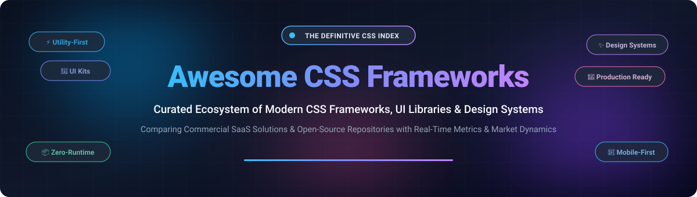

  

# 🎨 Awesome CSS Frameworks

  
  
  
  
  
  

---

## 🌟 Top CSS Frameworks Ecosystem

**A Curated List of SaaS Products & Open-Source GitHub Projects for Modern Frontend Development**  
*Covering Utility-First Styling, Responsive UI Component Libraries, Design Tokens & Design Systems.*  
📅 **Last updated: October 2026**

This repository tracks notable **SaaS platforms** and **open-source frameworks** for **CSS and Frontend UI engineering**. These tools enable developers to build accessible, lightning-fast, and maintainable user interfaces—from modern utility-first engines that purge unused styles to full-featured component systems and classless lightweight stylesheets.

---

## 📑 Table of Contents
- [📊 Sector Overview & Market Dynamics](#-sector-overview--market-dynamics)
- [💼 SaaS & Commercial Platforms](#-saas--commercial-platforms)
- [🚀 Open-Source GitHub Projects](#-open-source-github-projects)
  - [⭐ Ranked by GitHub_Stars](#-ranked-by-github-stars)
- [💡 Modern CSS Stack Recommendations](#-modern-css-stack-recommendations)
- [📈 Star History](#-star-history)
- [🤝 How to Contribute](#-how-to-contribute)
- [💖 Support & Sponsor](#-support--sponsor)
- [⚠️ Disclaimer](#-disclaimer)

---

## 📊 Sector Overview & Market Dynamics

The global web development software and frontend developer tooling sector is estimated at **$82.4 billion to $87.75 billion** (projected to reach over $160+ billion by the mid-2030s at an 8.5–9.4% CAGR), with dedicated frontend engineering toolchains and UI component frameworks capturing over $8 billion of that volume. 

The market dynamics exhibit a **moderately fragmented yet top-heavy distribution**: while foundational web traffic is historically dominated by legacy giants like Bootstrap (~74.8% of deployed sites) and greenfield projects by Tailwind CSS (>50% developer mindshare), the broader ecosystem remains vibrant and fragmented across zero-runtime CSS-in-TS solutions, accessible unstyled primitives (Radix, Headless UI), and specialized enterprise React/Vue component libraries rather than a single winner-take-all monopoly.

---

## 💼 SaaS & Commercial Platforms

| Platform | Valuation / Company Size | Starting Price | Free Tier Limits | Description |
| :--- | :--- | :--- | :--- | :--- |
| **[Tailwind Plus](https://tailwindcss.com/plus)** | Parent company **Shopify** is valued at **~$100B+ market cap** *(Tailwind Labs acquired in Sept 2026; previously ~$4M–$5M ARR)* | **$299** one-time lifetime license (historical standalone; new public sales closed post-acquisition) | **Free forever tier**: Unlimited access to official Tailwind CSS open-source framework, core utilities, and documentation with 0-day free trial restrictions; commercial templates & UI components require existing paid license | Premium official component library and production-ready templates by Tailwind Labs. Features 500+ handcrafted accessible components, full page kits, and design assets. |
| **[MUI X & Store](https://mui.com/pricing/)** | Bootstrapped market leader, **~$5M–$10M estimated annual revenue**, powers UI at Netflix, Amazon, Spotify | **$299 / developer / year** (MUI X Pro tier) | **Free forever community tier**: Community edition of MUI Core and basic MUI X Data Grid/Date Pickers free forever with MIT license; **30-day free evaluation** available for Pro/Premium features | Enterprise-grade advanced UI component suite (complex Data Grids, TreeViews, Charts, Date Range Pickers) alongside pre-built designer templates and Figma UI kits. |
| **[Bootstrap Themes](https://themes.getbootstrap.com/)** | Bootstrap ecosystem *(run by core team & partners, supporting ~74.8% of all CSS web traffic worldwide)* | **$49** standard single-application license | **Free forever tier**: Entire open-source Bootstrap framework, 2,000+ Bootstrap Icons, docs, and basic examples are free forever (MIT); official marketplace themes provide **0 free trial days** (paid digital goods) | Official curated marketplace for commercial Bootstrap themes, admin dashboards, landing pages, and interactive UI applications built by verified creators. |

---

## 🚀 Open-Source GitHub Projects

### ⭐ Ranked by GitHub_Stars

| Repository | GitHub_Stars | License | Description |
| :--- | :--- | :--- | :--- |
| **[twbs/bootstrap](https://github.com/twbs/bootstrap)** |  | MIT | 🌐 **The most popular HTML, CSS, and JS framework for responsive, mobile-first web projects.** Powers over 74% of known CSS framework websites. Version 5 features CSS custom properties, utility APIs, and zero jQuery dependency. |
| **[shadcn-ui/ui](https://github.com/shadcn-ui/ui)** |  | MIT | 🧩 **Beautifully designed, accessible components that you can copy and paste into your apps.** Combines Radix UI primitives with Tailwind CSS, giving developers direct source code ownership. |
| **[ant-design/ant-design](https://github.com/ant-design/ant-design)** |  | MIT | 🏢 **An enterprise-class UI design language and comprehensive React UI library.** Maintained by the Ant Group/Alibaba open-source team, featuring 60+ modular components and i18n support. |
| **[mui/material-ui](https://github.com/mui/material-ui)** |  | MIT | ⚛️ **The premier React component library implementing Google's Material Design.** Offers rich theming, CSS utilities, production accessibility, and Joy UI/Base UI alternatives. |
| **[tailwindlabs/tailwindcss](https://github.com/tailwindlabs/tailwindcss)** |  | MIT | ⚡ **A utility-first CSS framework for rapid modern UI development.** Version 4 features a high-performance Rust-powered Oxide engine, zero-config `@theme` directives, and tiny 6-12 KB production bundles. |
| **[animate-css/animate.css](https://github.com/animate-css/animate.css)** |  | MIT | 🎬 **A cross-browser library of CSS animations.** As easy to use as an easy thing. Ideal for emphasis, homepages, sliders, and interactive web delights. |
| **[necolas/normalize.css](https://github.com/necolas/normalize.css)** |  | MIT | 🛠️ **A modern, HTML5-ready alternative to CSS resets.** Preserves useful browser defaults rather than un-styling everything, standardizing HTML elements across all engines. |
| **[semantic-org/semantic-ui](https://github.com/semantic-org/semantic-ui)** |  | MIT | 🗣️ **UI component framework based on natural human language conventions.** Empowers developers to treat words and classes as exchangeable concepts. |
| **[jgthms/bulma](https://github.com/jgthms/bulma)** |  | MIT | 📦 **Modern CSS framework based on Flexbox with 0% JavaScript.** Provides clean semantic components without imposing any client-side JavaScript runtime or bundle overhead. |
| **[saadeghi/daisyui](https://github.com/saadeghi/daisyui)** |  | MIT | 🌼 **The most popular component library plugin for Tailwind CSS.** Adds semantic classes like `btn`, `card`, and `modal` to speed up authoring without massive inline class lists. |
| **[tabler/tabler](https://github.com/tabler/tabler)** |  | MIT | 📊 **Premium open-source responsive dashboard and UI kit based on Bootstrap 5.** Fully responsive with clean code, dark mode, customizable vectors, and hundreds of ready components. |
| **[chakra-ui/chakra-ui](https://github.com/chakra-ui/chakra-ui)** |  | MIT | ⚡ **Simple, modular and accessible component library for React applications.** Offers style props, built-in color mode management, and first-class WAI-ARIA compliance. |
| **[foundation/foundation-sites](https://github.com/foundation/foundation-sites)** |  | MIT | 🏗️ **The advanced responsive front-end framework for enterprise applications.** Built for robust multi-device layouts, email templates, and accessible interfaces. |
| **[postcss/postcss](https://github.com/postcss/postcss)** |  | MIT | ⚙️ **A tool for transforming CSS with JavaScript plugins.** Powers Autoprefixer, CSS nesting, modern polyfills, and module workflows across millions of build systems. |
| **[pure-css/pure](https://github.com/pure-css/pure)** |  | BSD-3-Clause | 🪶 **A set of small, responsive CSS modules (~3.5 KB gzipped).** Created by Yahoo, ideal for lightweight pages requiring responsive grids, forms, and tables without JavaScript. |
| **[radix-ui/primitives](https://github.com/radix-ui/primitives)** |  | MIT | 🛡️ **Unstyled, accessible UI components for building high-quality design systems and web apps in React.** Backing engine for shadcn/ui and modern headless architectures. |
| **[dhg/Skeleton](https://github.com/dhg/Skeleton)** |  | MIT | 💀 **A dead simple, responsive boilerplate (~2.7 KB gzipped).** Offers a clean 12-column grid and basic typography for quick static sites. |
| **[uikit/uikit](https://github.com/uikit/uikit)** |  | MIT | 🎨 **A lightweight and modular front-end framework.** Provides 50+ modular components with crisp visual styling and optional interactivity. |
| **[picocss/pico](https://github.com/picocss/pico)** |  | MIT | 🌿 **Minimal CSS Framework for semantic HTML without classes.** Turns vanilla HTML elements into responsive, dark-mode-ready modern pages automatically. |
| **[primer/css](https://github.com/primer/css)** |  | MIT | 🐙 **The official CSS framework that powers GitHub's front-end design system.** Implements modern utility classes, color tokens, and GitHub's battle-tested UI primitives. |
| **[picturepan2/spectre](https://github.com/picturepan2/spectre)** |  | MIT | 📐 **A lightweight, responsive and modern CSS framework (~10 KB gzipped).** Provides elegant flexbox layout, pure CSS components, and typography. |
| **[milligram/milligram](https://github.com/milligram/milligram)** |  | MIT | 🍃 **A minimalist CSS framework (~2 KB gzipped).** Designed for fast performance and clean aesthetics with minimal CSS specificity overrides. |
| **[kognise/water.css](https://github.com/kognise/water.css)** |  | MIT | 💧 **A drop-in classless collection of CSS styles.** Make semantic HTML look instantly beautiful with automatic light/dark mode and no custom classes needed. |
| **[sindresorhus/modern-normalize](https://github.com/sindresorhus/modern-normalize)** |  | MIT | 🧼 **Normalize browser default styles for modern browsers only.** Streamlined, zero-cruft baseline used by Tailwind CSS and modern bundlers. |

---

## 💡 Modern CSS Stack Recommendations

- **Utility-First Speed**: Combine **Tailwind CSS v4** with **DaisyUI** or **shadcn/ui** to achieve complete styling control without writing custom CSS files.
- **Enterprise Design Systems**: Use **Radix UI** or **MUI Core** integrated with design tokens via **Style Dictionary**.
- **Minimalist & Zero-Build Sites**: Adopt classless stylesheets like **Pico CSS** or **Water.css** for docs, portfolios, and static markdown sites.

---

## 📈 Star History

---

## 🤝 How to Contribute

1. 🍴 Fork this repository.
2. 📝 Add or edit entries in `README.md` maintaining proper alphabetical/star-sorted order and factual links.
3. 💬 Open a Pull Request with a clear description of your contribution.

---

## 💖 Support & Sponsor

Thank you for exploring and utilizing this curated index! 🌟

If you find this repository helpful for your projects, team, or frontend career, please consider:
- ⭐ **Starring** the repository to help others discover it
- 🍴 **Forking** and contributing new tools or corrections
- 📢 **Sharing** with fellow developers and designers
- ☕ **Sponsoring a coffee** via the [GitHub Sponsor Dashboard](https://github.com/sponsors/ishandutta2007)

Your support keeps this ecosystem up-to-date, transparent, and comprehensive!

---

## ⚠️ Disclaimer

- This is a **community-curated list** — not exhaustive and not a commercial endorsement.
- CSS frameworks must respect licensing terms. Permissive licenses (MIT, BSD-3-Clause) allow commercial re-distribution.
- Market shares and financial benchmarks represent curated industry data as of late 2026.

---

  <b>Crafted with ❤️ for frontend engineers, UI/UX designers, and open-source advocates.</b>

